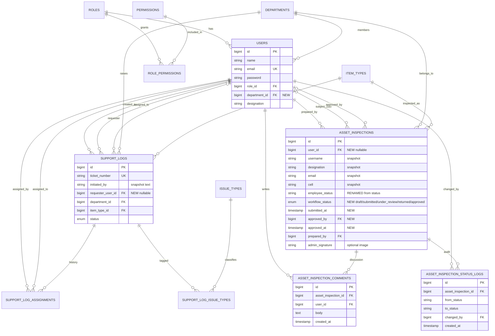

# CEF365
## All in one package for CEF ICT Department, Managing Report logs and asset inspection forms and much more

- **Support Logs (log-report)** and **Asset Inspection** with a cross-department approval workflow
- RBAC

# Schema

